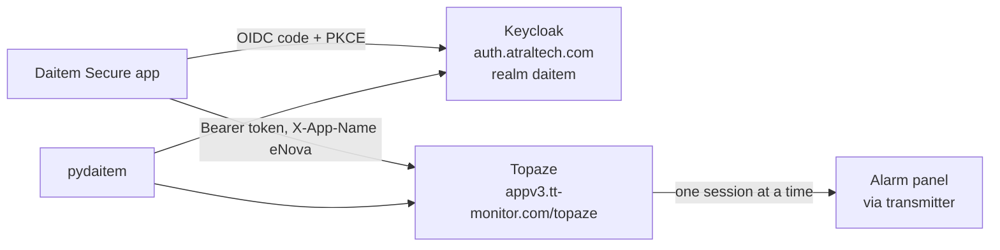

# Daitem Secure API map

Every network call the **Daitem Secure** iOS app (6.0.3, build 2026091101) makes, and where
pydaitem stands on each one.

- [openapi.yaml](openapi.yaml): the 78 calls with their headers and bodies, as OpenAPI 3.0.3.
  **The single source**: everything else here explains it. Open it in any OpenAPI viewer
  (Swagger UI, Redoc, an IDE plugin) to browse the calls by area.
- [Entities](entities.md): what the app manipulates, the panel states, and the library
  backlog.
- [Protocol reference](reference.md): sign-in settings, headers, retries, the 29 server error
  codes, command statuses and third-party services.

> The API is private and non-contractual. This map describes one app version.

## Objective and scope

**Objective**: know the whole API surface, so the library can be extended in the right order.

**Scope**: the app's own back end (Keycloak and Topaze). Third-party traffic (Firebase,
Google, Sentry, Lokalise, the Dahua video SDK) is listed at the end and left out of the map.

**Relation to the call reference**: 30 of the 78 operations carry `x-observed: true` in
[openapi.yaml](openapi.yaml), with their notes in `x-observed-notes`.
[api-daitem.md](../api-daitem.md) details them in prose: the API surface is described here,
their requests and answers there.

## Architecture

### Authentication

Keycloak authorisation code flow with PKCE S256, then `Authorization: Bearer <access token>` on
every Topaze call. Client, redirect URI and endpoints: [Protocol reference](reference.md#authentication).

### Headers

The app sets `X-App-Name` (`eNova`), `X-App-Version` and `X-App-Platform`. Each
operation declares its own optional headers (`X-SessionId`, `X-Vendor`, `X-Forwarded-For`).
Meanings: [Protocol reference](reference.md#headers). Per operation: [openapi.yaml](openapi.yaml).

The app declares `X-SessionId` on every operation, while pydaitem works without it.

### Panel session

`connect` opens the only session the panel allows, across all accounts. The app can also
receive an **asynchronous** answer and then polls `GET .../connect/{transactionId}` until
`status` is `DONE`. pydaitem polls it too, taking the transaction from the `Location` header
as for the logbook job.

## Library status

Every call in this map has a method in pydaitem's client, and some are also reached
through the stable façade (`DaitemSystem`): each operation's `x-coverage` says which. pydaitem also
applies the app's rules: the 13 raw states, the exit delay list, preset names, the 29 error
codes, the retry rules, command statuses and the deferred `connect`. See the
[changelog](../../CHANGELOG.md). Tests in `tests/test_api_spec_vs_library.py` hold the
library to this map. What it could still add: [library backlog](entities.md#library-backlog).

## Reference data

Explained in the other pages, listed in [openapi.yaml](openapi.yaml):

- [Panel states](entities.md#panel-states): the 13 raw values, the app's name for each, which
  ones are an exit delay, and how named presets move. In openapi.yaml: the `x-known-values`,
  `x-exit-delay-values`, `x-preset-sequences` and `x-app-names` of
  `TopazeSystemStateResult.systemState`.
- [Retries](reference.md#retries): the app's retry rules, one by one.
- [Server error codes](reference.md#server-error-codes): the 29 codes with what they mean for
  a client. In [openapi.yaml](openapi.yaml) they are the `x-known-values` of
  `TopazeExceptionMessage.message`.
- [Command statuses](reference.md#command-statuses) and
  [third-party services](reference.md#third-party-services).

## Open questions

| Question | Impact | How to settle it |
|---|---|---|
| Raw state while the alarm is sounding | High | Capture `GET .../state` during a test trigger |
| Paths of two operations whose path is built at run time | Low | Probably the follow-up of asynchronous jobs. Capture a firmware update |
| Keep-alive interval used by the app | Low | Compare with the 480 s pydaitem uses |
| Whether `X-SessionId` is ever required | Medium | Compare calls with and without it |

## Maintenance

Edit [openapi.yaml](openapi.yaml) by hand, then the page that explains the change if any.
It stays one file, factored rather than split:

- A parameter or a response used in several places lives once under `components`
  (`SystemId`, `SessionId`, `OkUnmodelled`...) and is referenced from there.
- A parameter every operation of a path takes is declared once, on the path itself.

Two test files keep it honest:

- `tests/test_api_spec.py`: the spec is consistent (every `$ref` resolves, every operation
  has an id and a coverage, the counts hold, shared parameters and responses stay factored) and the pages agree with it (the error codes
  in reference.md, the states in entities.md, the models entities.md names).
- `tests/test_api_spec_vs_library.py`: pydaitem follows it (every operation has a client
  method, the client calls nothing else, states, error codes, command statuses and retry
  rules are the same).
