# Entities of the mobile app

What Daitem Secure 6.0.3 manipulates, grouped by area. For every entity: where pydaitem
stands, and what the library could add next.
Calls behind each area: the tags of [openapi.yaml](openapi.yaml). Context: [README](README.md).

## Overview

```mermaid
classDiagram
    namespace Account {
        class UserInfo
        class UserPreference
    }
    namespace Installation_and_panel {
        class System
        class SystemState
        class Group
        class Alarm
        class SystemCode
    }
    namespace Devices {
        class SystemProducts
        class CentralInformation
        class Sensor
        class Command
        class Siren
        class Transmitter
        class Transceiver
        class Box
        class FireTrigger
        class PpmsTrigger
        class Firmware
    }
    namespace Automations {
        class Automatism
        class AutomatismCommand
    }
    namespace Scenarios {
        class Scenario
        class ScenarioAction
        class ScenarioConfiguration
    }
    namespace Arming_schedule {
        class ProgramList
        class Program
    }
    namespace Event_log {
        class Logbook
        class Log
    }
    namespace Video {
        class FilmDetails
        class Camera
        class VideoDeviceList
    }
    namespace Alerts_and_contacts {
        class NotificationReceiver
        class AlertEntry
    }
    namespace Users_and_rights {
        class User
        class Right
        class UserConfiguration
    }
    namespace Widgets {
        class Widget
        class WidgetItem
    }
    UserInfo --> System : has access to
    System --> SystemState : is in
    System --> Group : has
    System --> Alarm : has
    System --> SystemProducts : contains
    SystemProducts --> CentralInformation : has
    SystemProducts --> Sensor : has
    SystemProducts --> Command : has
    SystemProducts --> Siren : has
    SystemProducts --> Transmitter : has
    SystemProducts --> Transceiver : has
    SystemProducts --> Box : has
    SystemProducts --> FireTrigger : has
    SystemProducts --> PpmsTrigger : has
    Sensor --> Group : belongs to
    CentralInformation --> Firmware : runs
    System --> Automatism : drives
    System --> Scenario : runs
    Scenario --> ScenarioAction : made of
    System --> ProgramList : follows
    ProgramList --> Program : made of
    Program --> Group : arms
    System --> Logbook : records
    Logbook --> Log : made of
    System --> FilmDetails : stores
    System --> NotificationReceiver : alerts
    System --> User : has
    User --> Right : holds
    UserInfo --> Widget : arranges
    Widget --> WidgetItem : made of
```

## Panel states

| Raw value | Meaning | App name | Exit delay for the app |
|---|---|---|---|
| `off` | Disarmed | `off` |  |
| `tempo` | Exit delay, full arming | `delayOn` | yes |
| `tempogroup` | Exit delay, groups | `delayOnGroup` | yes |
| `tempo1` | Exit delay, first named preset | `delayPartial1` | yes |
| `tempo2` | Exit delay, second named preset | `delayPartial2` | yes |
| `on` | Fully armed | `on` |  |
| `group` | Groups armed directly | `onGroup` |  |
| `partial1` | First named preset armed | `onPartial1` |  |
| `partial2` | Second named preset armed | `onPartial2` |  |
| `presence` | Presence preset armed | `onPresence` |  |
| `apprent` | Installation (learning) mode | `modeInstallation` |  |
| `essai` | Test mode | `modeTest` |  |
| `""` | Empty value, a case of its own in the app | `unknown` |  |

pydaitem maps every raw value to its stable `PanelState` in
`RAW_TO_PANEL_STATE` (`src/pydaitem/const/semantics.py`).

A named preset moves `tempo1` then `partial1`, or `tempo2` then `partial2`. The value sent
while the alarm is **sounding** is not among these 13: no raw value maps to it yet.

`group` and `tempogroup` are handled together by the alarm group widget.

## Device list

The app's device screen has one section per family: `central`, `box`, `transmitter`, `command`, `sensor`, `siren`, `transceiver`, `camera`.

Fire and PPMS triggers are not devices for the app: it shows them as home screen widgets.

## Account

| Entity | Fields in the app | Wire model | In pydaitem |
|---|---|---|---|
| UserInfo | firstName, userUid, userId | `TopazeAuthUserInfo` | partly |
| UserPreference | systemCodeRemembered, biometricAuthAllowed, systemName, installer, isUserPrimary | app only | no |

## Installation and panel

| Entity | Fields in the app | Wire model | In pydaitem |
|---|---|---|---|
| System | vendor, topazeId, role, ttmSessionId, transmitterId, name, status, anomalies, gprsPhoneNumber, openedIssueNumbers, alarm, groups, rights, isTechnical | `TopazeSystem` | partly |
| SystemState | off, delayOn, delayOnGroup, delayPartial1, delayPartial2, on, onGroup, onPartial1, onPartial2, onPresence, modeInstallation, modeTest, unknown | `TopazeSystemStateResult` | yes |
| Group | groupId, groupName, isActive, rank | `TopazeGroup` | yes |
| Alarm | forcePushConfig, tls, isAlertConfigurable, isScenarioConfigurable | `TopazeConfiguration` | partly |
| SystemCode | code, codeSize | `TopazeSystemCode` | partly |

## Devices

| Entity | Fields in the app | Wire model | In pydaitem |
|---|---|---|---|
| SystemProducts | alarm, centralInformation, box, sensors, cameras, commands, sirens, transmitters, transceivers, fireTriggers, ppmsTriggers | `TopazeConfiguration` | yes |
| CentralInformation | serialNumber, type, anomalies, firmwares, plug, hasIOCard | `TopazeCentral` | yes |
| Sensor | serialNumber, type, groupId, isVideo, firmwares, isActionPending, groupName, group, lock | `TopazeSensor` | partly |
| Command | serialNumber, type | `TopazeCommand` | yes |
| Siren | serialNumber, type | `TopazeSiren` | yes |
| Transmitter | serialNumber, type, firmwares, plug | `TopazeTransmitter` | yes |
| Transceiver | serialNumber, type | `TopazeTransceiver` | yes |
| Box | name, serialNumber, anomalies, firmwares | `TopazeBox` | yes |
| FireTrigger | serialNumber, isTriggered | `TopazeFireTrigger` | yes |
| PpmsTrigger | serialNumber, type, isTriggered | `TopazePpmsTrigger` | yes |
| Firmware | type, currentVersion, updateFirmware | `TopazeDeviceFirmware` | yes |

## Automations

| Entity | Fields in the app | Wire model | In pydaitem |
|---|---|---|---|
| Automatism | id, name, state, availableCommands, category, mode | `TopazeAutomatism` | yes |
| AutomatismCommand | id, command, isActionPending | `SendCommandRequest` | yes |

## Scenarios

| Entity | Fields in the app | Wire model | In pydaitem |
|---|---|---|---|
| Scenario | id, name, active, triggerType, actions, isActionPending | `TopazeScenario` | yes |
| ScenarioAction | id, command, rank, type, typeId, value, label | `TopazeAction` | partly |
| ScenarioConfiguration | minDelay, maxDelay, triggers | `TopazeScenarioConfiguration` | partly |

## Arming schedule

| Entity | Fields in the app | Wire model | In pydaitem |
|---|---|---|---|
| ProgramList | isAllProgramsEnabled, maxProgramsCount, programs | `TopazeSystemScheduleConfiguration` | yes |
| Program | id, day, hour, minute, command, groups | `TopazeOnOffProgram` | yes |

## Event log

| Entity | Fields in the app | Wire model | In pydaitem |
|---|---|---|---|
| Logbook | id, response | `TopazeLogbookResponse` | yes |
| Log | date, details, filterable, title | `TopazeLog` | yes |

## Video

| Entity | Fields in the app | Wire model | In pydaitem |
|---|---|---|---|
| FilmDetails | id, timestamp, type, category, deviceUid, deviceLabel | `TopazeFilmDetails` | yes |
| Camera | cameraType, model, status, dahuaCloudInfo, dahuaInfo | `TopazeCamera` | yes |
| VideoDeviceList | id, sensors, cameras, videos | app only | no |

## Alerts and contacts

| Entity | Fields in the app | Wire model | In pydaitem |
|---|---|---|---|
| NotificationReceiver | id, userName, email, isSubscribedToAlertEmails, isSubscribedToAlertPushs, isSubscribedToAnomalyEmails, isSubscribedToAnomalyPushs, isSubscribedToStateChangePushs, type | `TopazeNotificationReceiver` | partly |
| AlertEntry | alarm, anomaly, stateChange | app only | no |

## Users and rights

| Entity | Fields in the app | Wire model | In pydaitem |
|---|---|---|---|
| User | id, role, firstname, name, mail, address, zipCode, city, country, phone, codeId, codeIndex, rights, systemCode | `TopazeUserListConfigurationResponse` | partly |
| Right | id, universe, isGranted, groupRights | `TopazeRights` | partly |
| UserConfiguration | maxSecondaryUsers, codeLength, restrictedCodeLength | `TopazeUserConfiguration` | partly |

## Widgets

| Entity | Fields in the app | Wire model | In pydaitem |
|---|---|---|---|
| Widget | id, title, isVisible, widgetType, items | `TopazeWidget` | partly |
| WidgetItem | id, name, customName, iconType, groups, isVisible, type | `TopazeWidgetItem` | partly |

## Library backlog

What the library could add next, area by area. Nothing here is scheduled yet.

1. **UserInfo, Widget**: Typed models, rather than the raw answers the client returns.
2. **System**: Keep transmitterId and isTechnical on the model (the client reads them raw).
3. **Alarm**: Expose isTlsEnabled and isPushNotifWithTlsEnabled.
4. **SystemCode**: Expose codeSize, so a caller can check a code's length before connecting.
5. **Sensor**: Expose isActionPending and lock.
6. **Firmware**: Expose latestVersion (updates start through client.devices).
7. **Right**: Read the connected user's rights from connect.
8. **WidgetItem**: Keep customName for preset labels.
