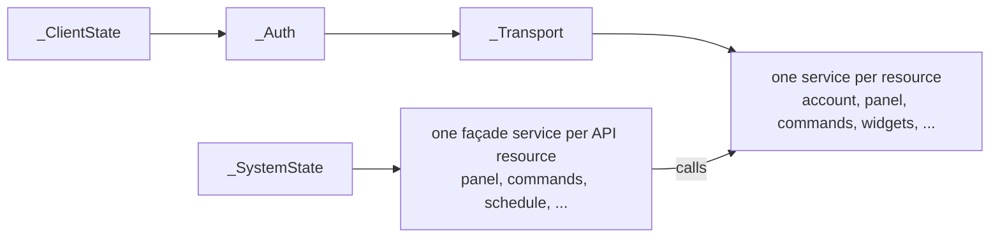

# Application architecture

How `pydaitem` itself is put together: package layout, the composition pattern used
throughout, and the choices that follow from being a standalone library rather than
something tied to a particular caller.

## Package layout

```
src/pydaitem/
  client/    Low-level client, one namespace per API resource, mirrors the API one for one.
             Every call of the API map has a method here.
  system/    Semantic façade bound to one installation: the stable, recommended surface.
  models/    Data classes returned by both layers, grouped by domain.
  const/     Network configuration, semantic vocabulary, and the raw-to-semantic mappings.
  cli/       Command line entry point.
  tokens.py       Refresh-token persistence protocol and implementations.
  credentials.py  Credential resolution for scripts and command line tools.
  exceptions.py   The exception hierarchy, rooted at `DaitemError`.
  _files.py       Private, atomic writes for files that hold a secret or personal data.
```

Outside the package, [docs/api/openapi.yaml](api/openapi.yaml) describes every call the
mobile app makes. `tests/test_api_spec_vs_library.py`
holds `client/` and `const/` to it: every operation has a method, and the raw states, exit
delay states, server messages, command statuses and retry rules are the same.

`client/` and `system/` are deliberately separate layers with different stability
guarantees (see the [stability promise](python.md#stability-promise)): `client/` changes whenever the Daitem
API does, `system/` absorbs that change so callers do not have to.

## Composition pattern

Both `client/` and `system/` are built the same way: a small, shared state object
(`_ClientState`, `_SystemState`) carries configuration and cross-cutting state (tokens, the
underlying HTTP session, the current panel session id), and every service receives exactly
the pieces it depends on through its constructor rather than reaching into a shared base
class.



The two entry points assemble these services and expose them as public attributes, one
namespace per resource, with no delegation boilerplate. The constructors are the
reference for who depends on whom: [`DaitemClient`](../src/pydaitem/client/__init__.py)
and [`DaitemSystem`](../src/pydaitem/system/__init__.py).

The façade follows the same resources as the API map (its tags), with method names of its
own: `system.panel.read()`, `system.video.cameras()`. A test holds it to the map. What is
not itself a resource stays a plain method or property on the entry point: `login`, `close`
and `token_url` on the client, `read_extras` and `collect_raw` on the façade, since both
span several resources. A dependency between two services
(`_Commands` needing `_Account` and `_Widgets` to list the arming presets, for instance) is
an explicit constructor argument, so it is visible and type-checked rather than an implicit
assumption about call order.

Shared plumbing lives once. On the client side, `_Transport` holds the retry rules, the
error mapping and the typed requests (`request_object`, `request_bytes`), and `jobs.py` the
polling of asynchronous answers. On the façade side, `_SystemState.session()` opens a panel
session and `extras.py` reads with at most one.

Each service, and each model cluster, lives in its own module, named after the resource it
covers (`account.py`, `panel.py`, `commands.py`, ...). A module stays private to its
package (classes carry a leading underscore). Only the entry points and the namespaces they
expose are public.

## Models

`models/` groups data classes by the domain they describe rather than by which endpoint
produced them. The [package docstring](../src/pydaitem/models/__init__.py) lists the
modules. Every class is a `dataclass(slots=True)` with a `from_json` constructor, and those
built from a whole answer keep it in `raw`, since the API is private and may add or drop
fields without notice. Nothing is validated strictly, and `models/_shared.py` holds the
lenient readers they share.

## Vocabulary and mappings

`const/` keeps the raw API vocabulary (`SystemState`, not part of the public contract)
separate from the vocabulary this library owns and guarantees (`PanelState`, `ArmMode`,
`Fault`), with the mapping between them centralised in a small number of dictionaries
(`RAW_TO_PANEL_STATE`, `RAW_TO_FAULT`). Server messages that call for a specific reaction
map to their own exception in one table in `client/transport.py`. An API value with no
entry degrades to `UNKNOWN` (or an `unknown_keys` entry) with a one-off warning, rather than
failing or silently reading as absent, so an API change surfaces in a consumer's logs
instead of vanishing.

## Dependency policy

A single runtime dependency, `aiohttp`. Keeping it to one avoids any resolution conflict
and keeps the library light enough to embed in any async environment; the client is async
throughout for the same reason a synchronous HTTP call would be a poor fit anywhere the
library runs inside someone else's event loop. The command line interface is built on
`argparse`, part of the standard library, so the convenience of a CLI does not add a
dependency of its own.

## Testing strategy

The suite runs requests against a real local `aiohttp` test server rather than mocking a
request library, so the real network stack (headers, status codes, response bodies) is
exercised end to end instead of asserting against a hand-written double of it.
